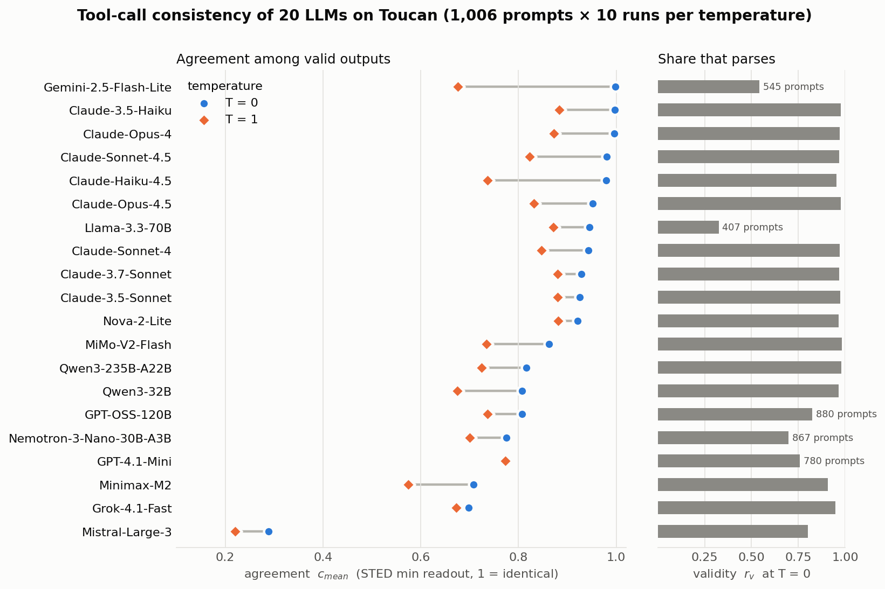

# STED: field-level comparison and consistency for structured LLM outputs

LLMs do not return the same JSON twice, even at temperature 0. STED tells you whether two
structured outputs (tool calls, JSON records) are the same, which fields differ, and how
consistent repeated runs of a prompt are, without being fooled by key order, `3` vs `"3"`,
or a reworded description, and without averaging a wrong argument away.

```python
import sted

r = sted.compare({"name": "book_flight", "arguments": {"to": "JFK", "passengers": 2, "date": "2026-12-01"}},
                 {"arguments": {"passengers": "2", "to": "JFK", "date": "2026-12-02"}, "name": "book_flight"})
print(r)
```

```
DIFFERENT  min 0.000  mean 0.833  (threshold 0.95)
  arguments.date                 "2026-12-01" -> "2026-12-02"   [changed, 0.000]
```

Library, `sted` command line (with CI exit codes) and an MCP server for agents. The core
install has no torch.

> 📄 **Paper**: [STED and Consistency Scoring: A Framework for Evaluating LLM Structured Output Reliability](docs/STED_and_Consistency_Scoring.pdf), NeurIPS 2025 Workshop on Structured Probabilistic Inference & Generative Modeling

## What's New

**November 2026 — v0.4.0**
- **Breaking: `AgentConsistencyEvaluator` reads text outputs like `sted.consistency`.**
  JSON text is parsed before comparison (`'{"a": 1}'` now equals `{"a": 1}`; before, it was
  compared as a string, so a changed value could still score 0.935), and text that is not
  JSON counts as invalid. `strict_json=False` / `parse_json=False` restore the old behaviour.
  This also changes `sted-eval`.
- `AgentConsistencyEvaluator` takes field rules (`ignore`, `unordered`, `tolerance`) and
  picks its text mode like `sted.compare`, so it works on the core install without torch.
- README: real `summary()` output, current performance numbers (threads do not speed up
  scoring of logged outputs), corrected production notes.

**November 2026 — v0.3.0**
- **Integrations**: LangSmith evaluators (per run and across `num_repetitions`) and an
  Inspect AI scorer and epoch reducer in the package, see [Integrations](#integrations).
- **Examples for Braintrust, W&B Weave, DeepEval, Ragas, MLflow and promptfoo** in
  [examples/integrations](examples/integrations/), run by CI against the frameworks'
  current releases, with a switch to run them against a real model.
- **Real-model checks** (`scripts/integration_checks/`): the adapters against Claude on
  Bedrock, and a throughput benchmark (300 examples × 5 runs in about 6 s).
- Fixed: Inspect `sted_match(answer_from="tool_calls")` missed tool calls under
  `generate()`'s default tool loop.

**November 2026 — v0.2.0**
- **Breaking: new default scoring.** `SemanticJsonTreeConsistencyEvaluator()` now uses
  `profile="typed"` (the *min readout*): a score of θ means every matched field scores at
  least θ, so a changed argument is no longer averaged away. Scores will differ from
  earlier releases; pass `profile="legacy"` to reproduce them exactly.
- **Two readouts.** `profile="typed"` decides whether two outputs are the same;
  `profile="typed_mean"` grades how far they drift. See the [profile table](#profiles-and-the-low-level-evaluator).
- **Type-aware leaves.** Literals (identifiers, dates, codes) compare exactly, numbers by
  value (`3` equals `"3"`), free text by embedding similarity.
- **20-model results** on Toucan tool calling across 11 temperatures, see
  [Results and Findings](#benchmark-20-llms).
- **MCP server** `sted-mcp` with `compare_outputs` and `evaluate_consistency` tools that
  report which fields differ, see [MCP Server](#mcp-server).
- **`sted.compare(a, b)` and `sted.consistency(outputs)`**: one call each, readable
  output, every differing or unstable field listed, see [Quick Start](#quick-start).
- **Field rules**: `ignore`, `unordered` (arrays as sets) and numeric `tolerance` by path
  pattern, in the library, the CLI and the MCP tools.
- **`sted` command**: `compare`, `consistency` and `diff` subcommands with CI exit codes,
  see [Command line](#command-line), and a GitHub Action that runs them.
- **Test helpers**: `sted.testing.assert_same`, `assert_consistent` and `assert_snapshot`
  (snapshot regression tests for LLM outputs), see [In your tests](#in-your-tests).
- **MCP server works with mcp 1.x and 2.x.**
- **Breaking: no torch by default.** The core install no longer pulls in
  sentence-transformers/torch and compares free-text fields by character similarity
  (with a one-time warning). To keep embedding-based scores, install
  `"sted[embeddings]"`; results report the mode in `text_similarity`.
- **Field-level differences**: `calculate_field_differences(a, b)` lists each differing
  field with its score; under `typed` the score is the lowest of them.
- Fixed a regular expression that could backtrack exponentially on long runs of spaces.

**May 2026**
- `AgentConsistencyEvaluator` with trajectory mode, an OpenTelemetry adapter and the
  `sted-eval` CLI.

**2025**
- STED and Consistency Scoring accepted at the NeurIPS 2025 Workshop on Structured
  Probabilistic Inference & Generative Modeling.

## Contents

- [What's New](#whats-new)
- [Installation](#installation)
- [Quick Start](#quick-start)
- [Command line](#command-line)
- [Integrations](#integrations)
- [MCP Server](#mcp-server)
- [Agents and production logs](#agents-and-production-logs)
- [How STED scores](#how-sted-scores)
- [Benchmark: 20 LLMs](#benchmark-20-llms)
- [Research](#research)
- [Contributing](#contributing) · [Citation](#citation)

## Installation

`sted` is not published on PyPI; `pip install sted` will not install this library.
Install it from GitHub instead:

```bash
# Core: no torch (~170 MB environment); text fields compared by character similarity
pip install "git+https://github.com/amazon-science/sted.git@v0.4.0"     # pin a release tag

# + semantic comparison of free-text fields with a local embedding model (pulls in torch)
pip install "sted[embeddings] @ git+https://github.com/amazon-science/sted.git"

# + MCP server
pip install "sted[embeddings,mcp] @ git+https://github.com/amazon-science/sted.git"
```

Which you need depends on your outputs. Tool calls, IDs, numbers, dates and enums are
compared exactly either way, so the core install is enough for most tool-calling checks.
Install `embeddings` when outputs carry free text (descriptions, queries, summaries) whose
wording may vary: `"hotels near the Louvre"` vs `"hotels close to the Louvre"` scores 0.98
with embeddings and 0.85 by characters. Every result reports which was used
(`text_similarity`); force one with `embedding_model="none"` or a model name, or set
`STED_EMBEDDING_MODEL`.

Or from a local clone:

```bash
git clone https://github.com/amazon-science/sted.git
cd sted
pip install -e .          # or: uv pip install -e .
pip install -e ".[embeddings,mcp]"   # with extras
```

For development:
```bash
pip install -e ".[dev]"
# Or: uv sync
```

### Troubleshooting (embeddings extra)

**NumPy/PyTorch Compatibility Error**

If you see `_ARRAY_API not found` or "module compiled using NumPy 1.x cannot be run in NumPy 2.x":

```bash
# Option 1: Downgrade NumPy (if using PyTorch < 2.4)
pip install "numpy<2"

# Option 2: Upgrade PyTorch (recommended)
pip install --upgrade "torch>=2.4"
```

## Quick Start

### Compare two outputs

```python
import sted

a = {"name": "book_flight", "arguments": {"from": "SEA", "to": "JFK", "passengers": 2,
                                          "request_id": "r-1", "seats": ["12A", "12B"], "price": 410.00}}
b = {"name": "book_flight", "arguments": {"to": "JFK", "from": "SEA", "passengers": "2",
                                          "request_id": "r-9", "seats": ["12B", "12A"], "price": 410.004}}

print(sted.compare(a, b))
```

```
DIFFERENT  min 0.000  mean 0.750  (threshold 0.95)
  arguments.price                410.0 -> 410.004   [changed, 0.000]
  arguments.request_id           "r-1" -> "r-9"   [changed, 0.000]
  arguments.seats[0]             "12A" -> "12B"   [changed, 0.000]
  arguments.seats[1]             "12B" -> "12A"   [changed, 0.000]
```

Key order and `2` vs `"2"` are not differences. The rest are, until you say otherwise:

```python
r = sted.compare(a, b,
                 ignore=["request_id"],          # drop this field (any depth)
                 unordered=["seats"],            # compare this array as a set
                 tolerance={"price": 0.01})      # numbers equal within 0.01
r.same            # True
r.differences     # []
```

`r.same` is `min_readout >= threshold` (default 0.95): the *lowest* field score, so one
wrong field is enough to make two outputs different. `r.mean_readout` averages the fields
instead, which grades drift but cannot decide sameness. `r.differences` lists every field
that differs with its score, and its lowest score is exactly `r.min_readout`.

### Rate the consistency of repeated runs

Ten runs of the same prompt, e.g. collected from your agent or from logs: six book Dec 1,
three book Dec 2, one refuses.

```python
def call(date, rid):
    return {"name": "book_flight", "arguments": {"from": "SEA", "to": "JFK", "date": date,
                                                 "passengers": 2, "request_id": rid}}

runs = ([call("2026-12-01", f"r-{i}") for i in range(6)]
        + [call("2026-12-02", f"r-{i}") for i in range(6, 9)]
        + ["Sorry, I can't book flights."])
print(sted.consistency(runs, ignore=["request_id"]))
```

```
validity 0.90 (9/10)   agreement min 0.500 / mean 0.938   same pairs 50% of 36
unstable fields:
  arguments.date                 differs in 50% of pairs   "2026-12-01" x6, "2026-12-02" x3
```

Outputs may be JSON values or JSON text; text that does not parse counts as invalid.
`.to_dict()` on either result gives plain JSON for logging or CI.

### Field rules

Patterns are matched against paths as STED prints them (`arguments.items[0].id`):

| Pattern | Matches |
|---|---|
| `request_id` | that key at any depth (a bare name is shorthand for `**.request_id`) |
| `arguments.request_id` | exactly that path |
| `items[*].id` | `id` in every element of `items` |
| `*.id` / `**.id` | `id` one level down / at any depth |

`ignore` drops matching fields from both outputs; `unordered` compares matching arrays as
multisets (other arrays stay positional, since the order of a list argument usually changes
the call); `tolerance` maps a pattern to an absolute tolerance, or to
`{"abs": a, "rel": r}`. The same rules are accepted by the MCP tools. For reuse, build them
once: `rules = sted.FieldRules(ignore=[...])`, then `sted.compare(a, b, rules=rules)`.

### In your tests

```python
from sted.testing import assert_same, assert_consistent, assert_snapshot

def test_booking_call():
    assert_snapshot(agent("Book SEA to JFK on Dec 1 for 2"), "snapshots/booking.json",
                    ignore=["request_id"])

def test_booking_is_stable():
    runs = [agent("Book SEA to JFK on Dec 1 for 2") for _ in range(5)]
    assert_consistent(runs, ignore=["request_id"], min_same=1.0)
```

The first run of `assert_snapshot` writes the snapshot; later runs compare against it and
fail with the fields that changed:

```
E   AssertionError: output differs from snapshot snapshots/booking.json (snapshot -> actual)
E   DIFFERENT  min 0.000  mean 0.875  (threshold 0.95)
E     arguments.date                 "2026-12-01" -> "2026-12-02"   [changed, 0.000]
E
E   If the change is intended, rerun with STED_UPDATE_SNAPSHOTS=1 to update snapshots/booking.json.
```

`assert_same(actual, expected)` compares two outputs directly. All three take the field
rules and `threshold`, and work under pytest, unittest or plain `assert`-style scripts.

## Command line

```bash
sted compare a.json b.json --ignore request_id      # which fields differ; exit 1 if different
sted consistency runs.jsonl --min-same 0.9          # which fields are unstable; exit 1 below 90% same pairs
sted diff before/ after/ --rules rules.json         # regression check by file; exit 1 if any differ
```

```
$ sted diff before after --rules rules.json
DIFFERENT  q2.json   min 0.000
  arguments.date                 "2026-12-01" -> "2026-12-02"   [changed, 0.000]
MISSING_AFTER q3.json

3 files: 1 different, 1 missing after, 1 same
```

`consistency` reads a JSON array or JSONL of outputs (a line that is not JSON counts as an
invalid output), or rows of `{"prompt": ..., "outputs": [...]}` and rates each prompt.
`diff` pairs files by relative path (`--glob`, default `*.json`). Rules come from
`--ignore` / `--unordered` / `--tolerance PATTERN=VALUE` or a JSON/YAML file with the
same three keys. `--json` prints machine-readable results. Exit codes: 0 same, 1 different,
2 usage or input error, so each command can gate a CI step.

### GitHub Action

```yaml
- uses: amazon-science/sted@v0.4.0
  with:
    command: diff                         # or compare / consistency
    args: expected/ actual/ --rules sted-rules.json
    # extras: embeddings                  # semantic comparison of free-text fields
```

The step installs sted, runs the command, writes its output to the job summary, and fails
when the outputs differ (output `exit-code`: 0 / 1 / 2). `args` is split on whitespace.

## Integrations

STED plugs into evaluation frameworks as a scorer; they keep the datasets, repetitions,
dashboards and review UI. Most of them can already rerun each example N times but only
average the per-run scores; these adapters compare the N outputs with each other.

### LangSmith

```python
from langsmith import evaluate
from sted.integrations.langsmith import sted_evaluator, sted_consistency_evaluator

evaluate(my_agent, data="booking-dataset",
         evaluators=[sted_evaluator(ignore=["request_id"])],                  # vs. reference
         summary_evaluators=[sted_consistency_evaluator(ignore=["request_id"])],
         num_repetitions=5)
```

`sted_evaluator` adds `sted_same`, `sted_min_readout` and `sted_mean_readout` to every run,
with the differing fields in the comment. `sted_consistency_evaluator` groups the
repetitions of each example and reports `sted_share_same`, `sted_agreement`,
`sted_consistent_examples` and `sted_validity`, with a comment such as
`arguments.date: unstable in 1 of 2`. Install with `pip install "sted[langsmith]"`.

### Inspect AI

```python
from inspect_ai import Task, Epochs
from sted.integrations.inspect_ai import sted_match, sted_agreement

Task(dataset=..., solver=...,
     scorer=sted_match(ignore=["request_id"]),          # output vs. target, JSON or tool calls
     epochs=Epochs(3, [sted_agreement(ignore=["request_id"]), "mean"]))
```

`sted_agreement` is an epoch reducer over the epochs' outputs, not their scores. With three
epochs where one booking drifts to another date, Inspect's `mean` reducer reports 0.667
(two of three epochs correct) and `sted_agreement` 0.333 (one of three epoch pairs gives
the same call). Install with `pip install "sted[inspect]"`.

### Braintrust, Weave, DeepEval, Ragas, MLflow, promptfoo

Copy-and-adapt examples, each a short runnable script that CI runs against the
framework's current release, are in [examples/integrations](examples/integrations/):

| Framework | Hook | Repeated runs |
|---|---|---|
| Braintrust | code scorer | `trial_count` + compare the trials' outputs |
| W&B Weave | `Scorer` | `trials` + `summarize` compares the trials' outputs |
| DeepEval / Confident AI | `BaseMetric` | `sted.consistency` on reruns |
| Ragas 0.4 | `@numeric_metric` | — |
| MLflow 3 / Databricks | `@scorer` returning `Feedback` | — |
| promptfoo | Python assertion | `sted consistency` on `--repeat` outputs |

The examples README also lists framework quirks found while writing them (for example,
DeepEval rebuilds metrics from their `__init__` parameters).

## MCP Server

`sted-mcp` serves STED over the [Model Context Protocol](https://modelcontextprotocol.io)
(stdio), so an agent can check its own outputs or compare runs. Requires Python ≥ 3.10;
works with `mcp` 1.x and 2.x.

```bash
pip install "sted[mcp] @ git+https://github.com/amazon-science/sted.git"

# Claude Code
claude mcp add sted -- sted-mcp
```

Claude Desktop (`claude_desktop_config.json`; Desktop does not read your shell `PATH`,
so give the absolute path printed by `which sted-mcp`):

```json
{ "mcpServers": { "sted": { "command": "/absolute/path/to/sted-mcp" } } }
```

| Tool | Input | Returns |
|---|---|---|
| `compare_outputs` | `output_a`, `output_b`, `threshold` (0.95), optional `ignore` / `unordered` / `tolerance` | `min_readout`, `mean_readout`, `same` (= min readout ≥ threshold), `differences` (each differing field: path, changed / missing / extra, both values, field score) |
| `evaluate_consistency` | `outputs` (2–50 generations of one prompt), `threshold` (0.95), optional `ignore` / `unordered` / `tolerance` | `validity`, `agreement_min`, `agreement_mean`, `share_same`, `unstable_fields` (which fields disagree, in what share of pairs, with the values seen), `least_agreeing_pair` with its `differences` |

Outputs can be JSON values or JSON text; text that does not parse counts as invalid.
With the `embeddings` extra, free-text fields are embedded locally with `all-MiniLM-L6-v2`
(override with `STED_EMBEDDING_MODEL`, or set it to `none` for character similarity), so
no cloud credentials are needed. The server loads its scoring stack before it starts
answering, about 8 s without and 20 s with embeddings on a laptop, after which calls take
milliseconds. For example, four runs of a search tool call, one of which is a refusal:

```json
{"n_outputs": 4, "n_valid": 3, "validity": 0.75,
 "agreement_min": 0.333, "agreement_mean": 0.833, "share_same": 0.333,
 "unstable_fields": [{"path": "arguments.limit", "share_of_pairs": 0.667,
                      "values": [{"value": 5, "count": 2}, {"value": 10, "count": 1}]}],
 "least_agreeing_pair": {"i": 0, "j": 2, "min_readout": 0.0,
   "differences": [{"path": "arguments.limit", "status": "changed", "a": 5, "b": 10, "score": 0.0}]}}
```

The refusal is invalid, the two runs that differ only in key order count as the same, and
`unstable_fields` names the one field that varies: `limit`. The minimum readout always
equals the lowest field score, so the listed differences fully explain it. The same
breakdown is available in Python as
`SemanticJsonTreeConsistencyEvaluator(profile="typed").calculate_field_differences(a, b)`.

## Agents and production logs

### AgentConsistencyEvaluator

For many prompts at once: score pre-collected outputs (production logs) or run a live
agent N times per prompt. Outputs may be JSON values or JSON text; text that is not JSON
counts as invalid. Field rules work as in `sted.compare`.

```python
from sted import AgentConsistencyEvaluator

def weather(days):
    return {"name": "get_weather", "arguments": {"city": "Seattle", "days": days}}

def flight(date, rid):
    return {"name": "book_flight", "arguments": {"to": "JFK", "date": date, "request_id": rid}}

evaluator = AgentConsistencyEvaluator(ignore=["request_id"])
report = evaluator.evaluate_outputs({
    "Get weather in Seattle": [weather(3), weather(3), weather(3), weather(5), weather(3)],
    "Book a flight to NYC": [flight("2026-12-01", "r1"), flight("2026-12-01", "r2"),
                             '{"name": "book_flight", "arguments": {"to": "JFK", "date": "2026-12-01"}}',
                             flight("2026-12-02", "r4"), "Sorry, I can't book flights."],
})
print(report.summary())
```

```
Agent Consistency Report
============================================================
Prompts evaluated:    2
Runs per prompt:      5

Mean consistency:     0.550  (low)
Mean validity:        0.900
Mean c_adj:           0.500  (deployment-aware)

Least consistent prompts:
  c_mean=0.500  r_v=0.80  | Book a flight to NYC
  c_mean=0.600  r_v=1.00  | Get weather in Seattle

Highest invalidity prompts (parseability issues):
  r_v=0.80  c_mean=0.500  | Book a flight to NYC
```

**Validity** ($r_v$) is the share of runs that produced parseable output; **consistency**
($c_\text{mean}$) is the mean pairwise STED over the parseable ones; $c_\text{adj}$ is
their product. The refusal makes the booking prompt's validity 0.80; of its four valid
calls three book Dec 1 and one Dec 2, so half the pairs agree. To run a live agent instead:
`evaluator.evaluate(agent_fn=my_agent, prompts=[...], n_runs=10)`. For one prompt's
outputs, `sted.consistency(outputs)` returns the same numbers plus the unstable fields.

### Performance

Measured on a MacBook (M-series, one Python process), default `typed` profile:

| Workload | Time |
|---|---:|
| 200 prompts × 10 runs (9,000 pairs), `evaluate_outputs` | 11.5 s (58 ms per prompt, ~1.3 ms per pair) |
| 300 prompts × 5 runs (3,000 pairs), `sted.consistency` per prompt | 6 s, in character or embedding mode |
| One prompt with 50 outputs (1,225 pairs) | 1.3 s |

`n_workers` threads do not speed up scoring of pre-collected outputs: scoring is CPU-bound
Python (13.9 s with 4 workers on the first workload, against 11.5 s with 1). They help
`evaluate`, where they overlap the agent calls. For very large logs, split them across
processes. Large arrays cost more because array elements are matched with the Hungarian
algorithm (O(n³)); `set_greedy_matching(True)` on a `SemanticJsonTreeConsistencyEvaluator`
trades exactness for speed. Reproduce
with `python scripts/integration_checks/scale_benchmark.py`.

### Production notes

`sted` is **Development Status :: 3 - Alpha**: suited to batch evaluation of logs, CI
checks and benchmarks; not yet to latency-critical online paths or regulated workloads.

| Concern | What to do |
|---|---|
| Per-pair time limit | `AgentConsistencyEvaluator(timeout_seconds=...)`; a timed-out pair is reported in the prompt's `error` |
| Very large batches | `evaluate_outputs_streaming(...)` yields results one prompt at a time |
| Logging | `logging.getLogger("sted")`, `sted.set_log_level("DEBUG")` |
| Embedding scores depend on the model | Pin `embedding_model` (or `STED_EMBEDDING_MODEL`); results report it in `text_similarity` |
| Dashboards, history, review UI | Use an evaluation platform, see [Integrations](#integrations) |

Batch CLI for production logs (one JSON row per prompt with `outputs`):

```bash
sted-eval --input production_logs.jsonl --output report.json
sted-eval --input small.jsonl --summary-only --log-level INFO
```

Async agents:

```python
import asyncio
from sted import AgentConsistencyEvaluator
from sted.agent_consistency_async import evaluate_async

async def my_async_agent(prompt):
    return await my_async_llm.ainvoke(prompt)

evaluator = AgentConsistencyEvaluator(n_workers=4)
report = asyncio.run(evaluate_async(evaluator, my_async_agent, prompts, n_runs=10))
```

## How STED scores

STED aligns two JSON trees and scores matched leaves with a type-aware kernel:

- **Typed leaves**: booleans/null and literals (identifiers, dates, codes, numbers) compare exactly; a JSON number equals a numeric string of the same value; free text compares by embedding similarity (or character similarity in the core install)
- **Readouts**: the min readout (`typed`, default) takes the worst matched field, so a threshold certifies every field; the mean readout (`typed_mean`) averages them to grade drift
- **Legacy profile**: embedding-aware labels/values, bag-style array matching, additive channels, and arithmetic-mean aggregation; retained for historical reproducibility
- **Hungarian matching**: computes the configured local assignment in O(n³) time
- **Field rules**: `ignore`, `unordered` and `tolerance` (see [Field rules](#field-rules)) apply before and during matching; the field-level differences always explain the min readout exactly

### Profiles and the low-level evaluator

```python
from sted.semantic_json_tree_consistency import SemanticJsonTreeConsistencyEvaluator

# Default profile "typed" = min readout (decides "the same")
same = SemanticJsonTreeConsistencyEvaluator()
# "typed_mean" = mean readout (grades drift)
drift = SemanticJsonTreeConsistencyEvaluator(profile="typed_mean")

ref       = {"name": "get_weather", "arguments": {"city": "Seattle", "days": 3, "units": "metric"}}
reordered = {"arguments": {"units": "metric", "days": "3", "city": "Seattle"}, "name": "get_weather"}
changed   = {"name": "get_weather", "arguments": {"city": "Seattle", "days": 5, "units": "metric"}}

for other in (reordered, changed):
    print(same.calculate_tree_edit_distance_opt(ref, other, variation_type="combined"),
          drift.calculate_tree_edit_distance_opt(ref, other, variation_type="combined"))
# 1.0   1.0     key order and "3" vs 3 are harmless
# 0.0   0.833   a changed argument: min rejects, mean only dips
```

Other profiles are kept as ablations and for reproducing earlier results:

| Profile | What it is |
|---|---|
| `typed` (default) | Min readout: positional arrays, exact keys, typed leaves, bottleneck aggregation |
| `typed_mean` | Mean readout: same as `typed` with arithmetic-mean aggregation |
| `path_f1` (alias `ranking`) | Harmonic mean of path-anchored soft precision/recall; a ranker, not a threshold |
| `certificate` | Bottleneck with literal character leaves (earlier threshold profile) |
| `rank` | Order-adaptive arrays, bottleneck, legacy leaf kernel |
| `legacy` | Original embedding/additive/mean scoring from the NeurIPS 2025 workshop paper |

```python
legacy = SemanticJsonTreeConsistencyEvaluator(profile="legacy", model_id="all-MiniLM-L6-v2")
```

### Algorithm complexity

- Tree construction: O(n)
- Embedding computation: O(k) with caching
- Optimized STED: O(n₁ × n₂ × (n₁ + n₂))
- Hungarian algorithm: O(max(n₁, n₂)³)

See [STED Complexity Analysis](./docs/api/sted_complexity_analysis.md) for details.

## Benchmark: 20 LLMs



**20 LLMs** on Toucan tool calling: 1,006 prompts, 10 generations per prompt at each of
11 temperatures (0.0–1.0), scored with STED's min readout (`profile="typed"`).
Agreement $c_{mean}$ is the mean pairwise STED among a prompt's *valid* outputs, averaged
over the prompts with at least two valid outputs (prompts with fewer are left out, not
scored 0; the right panel gives their count where validity is low). Validity $r_v$ is the
share of outputs that parse. They are reported separately.

- **No model is fully consistent at T = 0.** Among models that parse in at least 95% of
  runs, agreement ranges from 0.81 (Qwen3-32B) to 0.998 (Claude-3.5-Haiku); Mistral-Large-3
  is lowest overall (0.29).
- **Temperature lowers agreement, by a model-specific amount.** Claude-Haiku-4.5 drops from
  0.98 to 0.74 between T = 0 and T = 1, Llama-3.3-70B from 0.95 to 0.87; GPT-4.1-Mini is
  unchanged (0.77).
- **Validity and agreement are different axes.** Llama-3.3-70B parses only 32% of the time
  but agrees at 0.95 when it does; Gemini-2.5-Flash-Lite parses 54% and agrees at 0.999;
  Grok-4.1-Fast parses 95% but agrees at 0.70. Scoring prompts without two valid outputs as
  0 would mix the two (Llama-3.3-70B would drop to 0.38).

*Correction (November 2026): an earlier version of this section and figure counted prompts
with fewer than two valid outputs as agreement 0, which mixed validity into agreement.*

The model list, how the outputs were generated, and the earlier benchmark in the
NeurIPS 2025 workshop paper are in [docs/research](docs/research/README.md).

## Research

STED started as a research metric. The datasets, LLM generation pipeline, effectiveness
studies and validation experiments live in [docs/research](docs/research/README.md); the
scripts are under `scripts/` and `research/`. Research utilities in the package
(`sted.llm_judge`, `sted.consistency_predictor`, `sted.consistency_risk_assessor`,
`sted.information_consistency`, `sted.bedrock_utils`, `sted.model_config`) are not part of
the stable API.

## Contributing

1. Fork the repository
2. Create a feature branch
3. Make your changes
4. Add tests if applicable
5. Submit a pull request

## Citation

If you use this framework in your research, please cite:

```bibtex
@inproceedings{wang2025sted,
  title={STED and Consistency Scoring: A Framework for Evaluating LLM Structured Output Reliability},
  author={Wang, Guanghui and Yu, Jinze and Zhang, Xing and Jiang, Dayuan and Deb, Tomal and Liu, Xuefeng and He, Peiyang and Song, Yin},
  booktitle={NeurIPS 2025 Workshop on Structured Probabilistic Inference \& Generative Modeling},
  year={2025}
}
```
