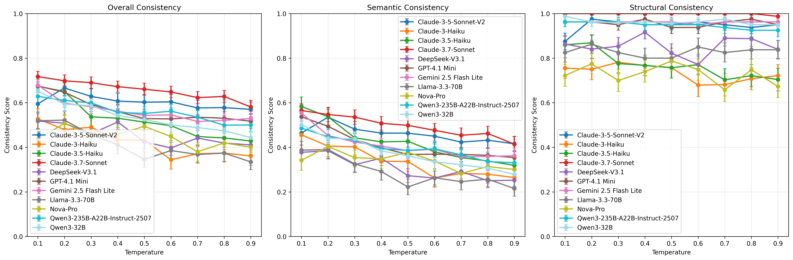

# STED research notes

Material from the research phase of STED: datasets, the LLM generation pipeline used to
build the consistency benchmark, effectiveness studies, and the older batch API. The tool
documentation is the top-level [README](../../README.md).

## Credentials for generation and Bedrock embeddings

**AWS Credentials** (for Bedrock embedding models):
```bash
aws configure
# Or set: AWS_ACCESS_KEY_ID, AWS_SECRET_ACCESS_KEY, AWS_DEFAULT_REGION
```

**OpenAI API Key** (optional, for OpenAI model evaluation):
```bash
export OPENAI_API_KEY=<your-openai-api-key>
```

## Dataset

The framework supports two datasets for evaluation:

### ShareGPT Dataset (Structured Output)

JSON structured output generation tasks:
- **sharegpt-structured-output-json**: 30 samples (report extraction, data parsing)
- **sharegpt-quizz-generation-json-output**: 50 samples (MCQ generation)
- **Total**: 80 samples (75 valid after parsing error exclusion)

```bash
# Download ShareGPT data
python scripts/data/download/download_sharegpt_data.py
```

### Toucan Dataset (Tool Calling)

Tool/function calling evaluation dataset:
- **Source**: [Nexusflow/Toucan](https://huggingface.co/datasets/Nexusflow/Toucan)
- **Content**: Multi-turn conversations with tool calls
- **Use case**: Evaluating LLM tool calling consistency

```bash
# Download Toucan data
python scripts/data/download/download_toucan_data.py
```

### Generate Synthetic Datasets

For STED effectiveness verification:

```bash
python scripts/data/generate_synthetic_datasets.py --base-dataset-dir sharegpt_data
```

Creates three variation types:
- **Schema Variation**: Field name changes, structure flattening/nesting
- **Expression Variation**: Different expressions with same semantic meaning
- **Semantic Variation**: Changes in semantic content

## STED Effectiveness Verification

### Similarity Progression Analysis

```bash
python scripts/dataset_analysis/analyze_semantic_expression_variation_progression.py \
  synthetic_dataset/expression_variation_dataset_*.json \
  synthetic_dataset/semantic_variation_dataset_*.json \
  --output-dir results/variation_progression
```

### Visualization

```bash
# Expression and Semantic Variation
python scripts/visualization/visualize_variation_progression.py

# Schema Variation
python scripts/visualization/visualize_schema_variation.py
```

## LLM Consistency Benchmarking

The framework supports two experiment modes for different datasets:

| Mode | Dataset | Use Case |
|------|---------|----------|
| `structured` | ShareGPT | JSON structured output generation (MCQ, reports, etc.) |
| `tool-calling` | Toucan | Tool/function calling evaluation |

### Model Setup

The framework supports models from multiple providers. Model configuration is centralized in `sted/model_config.py`:

```python
# sted/model_config.py
MODEL_REGISTRY = {
    # model_id -> (provider, display_name)
    "us.anthropic.claude-3-7-sonnet-20250219-v1:0": ("bedrock", "Claude-3.7-Sonnet"),
    "us.deepseek.v3-v1:0": ("bedrock", "DeepSeek-V3.1"),
    "openai/gpt-4o": ("openai", "GPT-4o"),
    "google/gemini-2.5-pro": ("openai", "Gemini-2.5-Pro"),
    # ... add more models here
}
```

**Provider Types:**

| Provider | Model ID Format | API Used | Credentials |
|----------|----------------|----------|-------------|
| `bedrock` | `us.<provider>.<model>-v1:0` | AWS Bedrock Converse API | AWS credentials |
| `openai` | `<provider>/<model>` | OpenAI-compatible API | `OPENAI_API_KEY`, `OPENAI_BASE_URL` |

**To add a new model:**

1. Add entry to `MODEL_REGISTRY` in `sted/model_config.py`:
   ```python
   "us.meta.llama3-3-70b-instruct-v1:0": ("bedrock", "Llama-3.3-70B"),
   ```

2. **Configure credentials** in `.env`:
   ```bash
   # For Bedrock models - only AWS credentials needed (via aws configure)
   
   # For OpenAI-compatible APIs - set these environment variables
   OPENAI_API_KEY=<your-api-key>
   OPENAI_BASE_URL=https://openrouter.ai/api/v1  # Optional, for OpenRouter
   ```

**Note**: When using Bedrock models, you don't need to set `OPENAI_API_KEY`. The script only requires OpenAI credentials when using models with the `"openai"` provider type.

### Step 1: Generate LLM Outputs

#### ShareGPT Experiment (Structured Output)

For JSON structured output generation tasks (MCQ generation, report extraction, etc.):

```bash
# Download ShareGPT data first
python scripts/data/download/download_sharegpt_data.py

# Run temperature experiment
python scripts/eval/run_temperature_experiment.py \
  --mode structured \
  --data-dir sharegpt_data \
  --output-dir llm_gen_results/sharegpt \
  --model-id us.anthropic.claude-3-5-haiku-20241022-v1:0 \
  --max-tokens 8000
```

**Key parameters:**
- `--mode structured`: Use structured output mode (default)
- `--data-dir`: Directory containing ShareGPT JSON files
- `--run-num`: Number of inference runs per sample (default: 10)
- `--sample-limit`: Maximum samples to process (default: all samples)
- `--include-schema`: Include JSON schema in prompt for better formatting

#### Toucan Experiment (Tool Calling)

For tool/function calling evaluation:

```bash
# Download Toucan data first
python scripts/data/download/download_toucan_data.py

# Run temperature experiment
python scripts/eval/run_temperature_experiment.py \
  --mode tool-calling \
  --dataset-path toucan_data/toucan_tool_calls.json \
  --output-dir llm_gen_results/toucan \
  --model-id us.anthropic.claude-3-5-haiku-20241022-v1:0 \
  --max-tokens 1024
```

**Key parameters:**
- `--mode tool-calling`: Use tool calling mode
- `--dataset-path`: Path to Toucan dataset JSON file
- `--run-num`: Number of inference runs per sample (default: 10)
- `--sample-limit`: Maximum samples to process (default: all samples)
- `--max-workers`: Parallel workers for inference (default: 10)
- `--start-idx`: Starting index in dataset (default: 0)

#### Running Individual Temperatures

For finer control, you can run `generate_structured_outputs.py` or `generate_tool_calls.py` directly:

```bash
# ShareGPT - single temperature
python scripts/eval/generate_structured_outputs.py \
  --data-dir sharegpt_data \
  --output-dir llm_gen_results/sharegpt/generations-model-timestamp \
  --temperature 0.5 \
  --model-id us.anthropic.claude-3-5-haiku-20241022-v1:0

# Toucan - single temperature
python scripts/eval/generate_tool_calls.py \
  --dataset-path toucan_data/toucan_tool_calls.json \
  --dataset-type toucan \
  --output-dir llm_gen_results/toucan/generations-model-timestamp \
  --temperature 0.5 \
  --model us.anthropic.claude-3-5-haiku-20241022-v1:0
```

### Step 2: Calculate Consistency Metrics

```bash
python scripts/eval/calculate_consistency_metrics.py
```

### Step 3: Visualize Results

```bash
python scripts/visualization/visualize_consistency_scores.py
```



For all scripts, see [Scripts Reference](../guides/SCRIPTS_REFERENCE.md).

## Models in the 20-model benchmark

| Provider | Models |
|----------|--------|
| Anthropic | Claude 3.5 Haiku, Claude 3.5 Sonnet, Claude 3.7 Sonnet, Claude Sonnet 4, Claude Opus 4, Claude Haiku 4.5, Claude Sonnet 4.5, Claude Opus 4.5 |
| Amazon | Nova 2 Lite |
| OpenAI | GPT-4.1 Mini, GPT-OSS-120B |
| Google | Gemini 2.5 Flash Lite |
| Meta | Llama 3.3 70B |
| Alibaba | Qwen3 32B, Qwen3 235B A22B |
| Mistral | Mistral Large 3 (675B) |
| NVIDIA | Nemotron 3 Nano 30B A3B |
| xAI | Grok 4.1 Fast |
| MiniMax | MiniMax M2 |
| Xiaomi | MiMo V2 Flash |

The NeurIPS 2025 workshop paper evaluated an earlier set of 19 models (Claude 3/3.5/3.7,
Nova, Llama 3.1/3.3/4, GPT-4o, Gemini 2.5, DeepSeek V3, Qwen3) with the `legacy` profile.

## Variation types used by the synthetic suite

| Type | Description | Example |
|------|-------------|---------|
| Schema | Field name/structure changes | `"user_name"` → `"userName"` |
| Expression | Linguistic variations, same meaning | `"good book"` → `"nice book"` |
| Semantic | Content meaning changes | Should trigger alerts |

## Older batch API: StructuralConsistencyAnalyzer

Superseded by `sted.consistency(outputs)`; kept for scripts that still use it.

```python
from sted.semantic_json_tree_consistency import SemanticJsonTreeConsistencyEvaluator
from sted.structural_consistency_analyzer import StructuralConsistencyAnalyzer

evaluator = SemanticJsonTreeConsistencyEvaluator()
analyzer = StructuralConsistencyAnalyzer(evaluator)

# Multiple LLM outputs for the same prompt
json_outputs = [
    {'name': 'Alice', 'age': 25, 'city': 'New York'},
    {'name': 'Alice', 'age': 25, 'city': 'NYC'},
    {'name': 'Alice', 'age': 25, 'location': 'New York City'},
]

result = analyzer.evaluate_structural_consistency(
    json_outputs, method_name="ted", variation_type="combined"
)
print(f"Consistency: {result['consistency_metrics']['consistency_coefficient']:.4f}")
```

For more examples, see `examples/basic_usage.py` and [Library Usage Guide](../guides/LIBRARY_USAGE.md).
